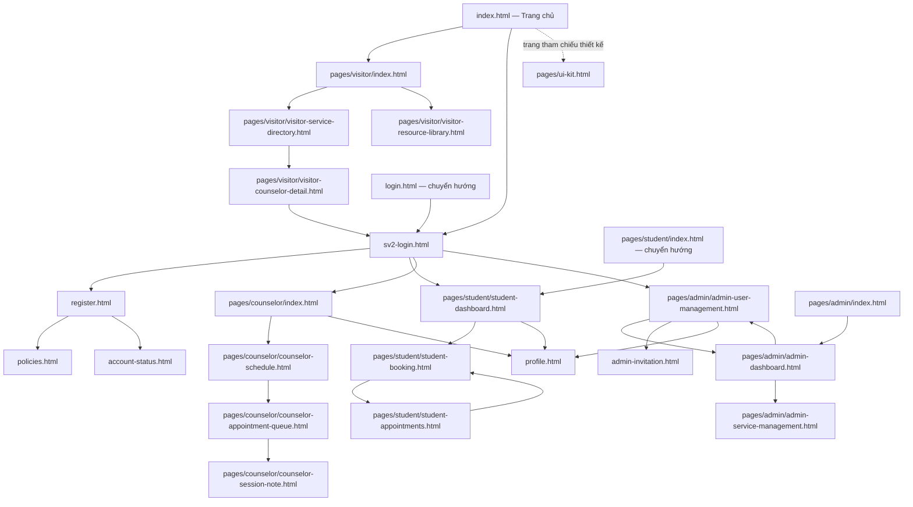

# CampusMind — Bản đặc tả đề tài

**CSE122 · Nhóm 1 · Cập nhật 26/10/2026.** Phạm vi: prototype điều phối hỗ trợ sức khỏe tinh thần sinh viên. Đối chiếu PDF `00_BAREM_CHAM_DIEM_VA_QUY_CHE_VAN_DAP_BTL.pdf` do người dùng cung cấp (nguyên tắc truy vết, tiêu chí 1.1–1.3, 2, 6–8), [README](../README.md), mã nguồn `dev` và [Trello nhóm](https://trello.com/b/tijjtgu7/cse122-campusmind-team-1). Giữ tên `docs/projectproposal.md` theo yêu cầu; barem có chỗ ghi `project-proposal.md`.

## 1. Ngữ cảnh thực tế

**CTX-01 — tình huống minh họa:** Minh là sinh viên năm nhất tại một trường đại học, đang căng thẳng trước kỳ thi và muốn gặp chuyên viên hỗ trợ tâm lý của trường. Minh tìm thông tin qua nhiều bài đăng nhưng không biết dịch vụ nào phù hợp, chuyên viên nào còn lịch, hay yêu cầu vừa gửi đã được xác nhận chưa. Minh phải nhắn tin nhiều lần, trong khi lịch học thay đổi khiến em cần đổi buổi gặp.

Chuyên viên phải đối chiếu tin nhắn với lịch làm việc, phản hồi từng yêu cầu và ghi lại nội dung sau buổi gặp. Bộ phận quản trị cần duy trì danh mục dịch vụ, tài khoản và theo dõi hoạt động. CampusMind tập trung các bước tìm hiểu → đặt lịch → xử lý lịch → ghi nhận buổi gặp để các vai trò sử dụng cùng thông tin. Bản hiện tại dùng dữ liệu giả, không thay thế dịch vụ tham vấn hoặc chẩn đoán; chỉ nhập dữ liệu thử nghiệm.

## 2. Phát biểu vấn đề P1–P4

| Mã | Nhóm người dùng | Vấn đề và ví dụ cụ thể |
|---|---|---|
| P1 | Visitor, Student | Khó tìm hỗ trợ phù hợp: Minh đọc nhiều bài đăng nhưng chưa phân biệt được dịch vụ, chuyên viên và tài nguyên liên quan đến áp lực học tập. |
| P2 | Student | Thiếu thông tin khung giờ và tiến độ: Minh gửi yêu cầu nhưng không biết còn chỗ hay đã được xác nhận; khi trùng tiết học phải liên hệ lại để đổi/hủy. |
| P3 | Counselor | Lịch, yêu cầu và ghi chú phân tán: chuyên viên phải kiểm tra từng tin nhắn để tránh trùng buổi gặp, rồi tìm lại ghi chú khi theo dõi sinh viên. |
| P4 | Admin | Thông tin vận hành dễ lệch: dịch vụ đã tạm ngưng vẫn có thể được giới thiệu, tài khoản không còn hoạt động cần vô hiệu hóa và số liệu lịch hẹn cần tổng hợp. |

## 3. Mục tiêu O1–O7

Mã màn hình được định nghĩa cùng đường dẫn thật trong [screen-inventory.md](screen-inventory.md). Đây là tiêu chí nghiệm thu nghiệp vụ, không phải tuyên bố mọi minh chứng đã hoàn tất.

| Mã | Mục tiêu có thể kiểm tra | Vấn đề | Màn hình |
|---|---|---|---|
| O1 | Tìm/lọc dịch vụ, đọc hồ sơ chuyên viên và tài nguyên để chọn hướng hỗ trợ. | P1 | V01–V03 |
| O2 | Đăng ký/đăng nhập, cập nhật hồ sơ đúng vai trò và biết trạng thái tài khoản. | P2, P4 | G01–G04, A03 |
| O3 | Chọn khung giờ còn trống, gửi đặt lịch hợp lệ và thấy lịch chờ xác nhận. | P2 | S01–S03 |
| O4 | Theo dõi, đổi hoặc hủy lịch của mình khi còn được phép; thấy trạng thái mới. | P2 | S02–S03 |
| O5 | Quản lý khung giờ, xác nhận/hủy lịch, lưu ghi chú và hoàn thành buổi gặp được phân công. | P3 | C01–C03 |
| O6 | Xem tổng quan, thêm/sửa/lưu trữ dịch vụ, quản lý trạng thái và vai trò tài khoản. | P4 | A01–A03 |
| O7 | Cung cấp ba trợ lý mô phỏng có lý do và quyền kiểm soát: Support Navigator, Resource Recommender, Counselor Summary Assistant. | P1, P2, P3 | S01, V02, C03 |

O7 phải thể hiện: nhập dữ liệu → đang xử lý → kết quả → giải thích → chấp nhận/sửa/từ chối/tạo lại → lưu/áp dụng. Khi thiếu dữ liệu hoặc kết quả không chắc chắn, hướng dẫn bổ sung/thử lại; không tự lưu kết quả chưa được chấp nhận. Trạng thái tải, rỗng, lỗi và thông báo thành công áp dụng theo từng màn hình.

## 4. Vai trò người dùng

| Role | Mục tiêu chính | Quyền thao tác trong phạm vi nghiệp vụ |
|---|---|---|
| Visitor | Tìm hiểu hỗ trợ trước khi tạo tài khoản. | Xem/tìm/lọc dịch vụ, chuyên viên, tài nguyên; dùng gợi ý tài nguyên; chuyển đến đăng ký/đăng nhập. |
| Student | Đặt và quản lý buổi gặp của mình. | Cập nhật hồ sơ cá nhân; xem giờ trống; tạo, đổi, hủy và theo dõi lịch của mình; dùng Support Navigator. |
| Counselor | Tổ chức lịch và theo dõi buổi gặp phụ trách. | Quản lý khung giờ; xem/xác nhận/hủy lịch được phân công; đọc, sửa, lưu ghi chú; duyệt tóm tắt AI và đánh dấu hoàn thành. |
| Admin | Duy trì dữ liệu và tài khoản hoạt động đúng. | Xem tổng quan; thêm/sửa/lưu trữ dịch vụ; tìm/lọc, tạo/sửa, bật/tắt tài khoản và xử lý phê duyệt chuyên viên; không tự vô hiệu hóa tài khoản đang dùng hoặc quản trị viên hoạt động cuối cùng. |

Đây là phân quyền nghiệp vụ của prototype. [README](../README.md#8-tài-khoản-thử-nghiệm) nêu rõ phiên demo chưa có bảo vệ máy chủ; không coi giao diện phân vai là bảo mật cho hồ sơ thật.

## 5. Thực thể dữ liệu và vòng đời trạng thái

| Thực thể | Trạng thái | Phép chuyển được phép và điều kiện |
|---|---|---|
| Tài khoản | `active`, `disabled` | Tạo → active; Admin bật/tắt active ↔ disabled theo ràng buộc mục 4. Đổi role bị chặn khi còn lịch Pending/Confirmed. |
| Hồ sơ chuyên viên chờ duyệt | chờ duyệt, `approved`, `rejected` | Gửi → chờ duyệt; Admin duyệt → approved/active hoặc từ chối có lý do → rejected/disabled. Phê duyệt là trạng thái riêng với trạng thái tài khoản. |
| Dịch vụ | `active`, `inactive`, `archived` | Tạo active/inactive; active ↔ inactive; active/inactive → archived sau xác nhận. Archived chỉ xem, chưa có thao tác khôi phục trên giao diện. |
| Khung giờ | còn trống, bị chiếm, không khả dụng | Chuyên viên tạo giờ không trùng; đặt lịch hợp lệ làm giờ bị chiếm; hủy/đổi giải phóng giờ cũ nếu còn hợp lệ. Giờ đã qua, bị khóa hoặc chuyên viên ngừng hoạt động không được đặt. Đây là trạng thái suy ra. |
| Lịch hẹn / yêu cầu đặt lịch | `Pending`, `Confirmed`, `Completed`, `Cancelled` | Tạo → Pending; Counselor: Pending → Confirmed, Pending/Confirmed → Cancelled, Confirmed → Completed khi lưu ghi chú hoàn thành. Student: Pending/Confirmed → Cancelled hoặc đổi giờ → Pending nếu lịch chưa diễn ra và giờ mới hợp lệ. Completed/Cancelled không mở lại. Không tách thêm thực thể yêu cầu trùng với lịch hẹn. |
| Ghi chú buổi gặp | chưa lưu, đã lưu, có chỉnh sửa | Nhập → lưu → sửa → lưu lại; áp dụng cho lịch Confirmed/Completed thuộc chuyên viên. Hoàn thành buổi gặp cập nhật lịch thành Completed; ghi chú vẫn có thể chỉnh sửa. Đây là vòng đời thao tác, không có trường trạng thái riêng. |
| Tài nguyên / mục đã lưu | có trong thư viện; chưa lưu, đã lưu | Đọc/tìm/lọc; lưu hoặc bỏ lưu trong danh sách cá nhân. Không đặt quy trình xuất bản/duyệt vì repo chưa có màn hình quản trị tài nguyên. |
| Gợi ý AI mô phỏng | nhập, xử lý, kết quả, lỗi/thiếu dữ liệu, đã áp dụng | Nhập → xử lý → kết quả hoặc lỗi; kết quả → chỉnh sửa/chấp nhận/lưu, từ chối hoặc tạo lại; lỗi → bổ sung/thử lại. Đây là trạng thái tương tác, không phải trạng thái lịch hẹn. |

Không đặt trùng giờ sinh viên/chuyên viên; thao tác thất bại phải giữ dữ liệu cũ. Vòng đời trên được đối chiếu với hành vi hiện tại, không khẳng định backend đã triển khai.

## 6. User Goal → User Task → User Flow

Mã U là nhiệm vụ người dùng, khác mã TASK trên Trello. Các bước mỗi dòng tạo thành luồng đầu–cuối; trạng thái lỗi quay lại bước nhập/chọn tương ứng.

| Flow / Role | User Goal | User Task | User Flow |
|---|---|---|---|
| F-V / Visitor | Tìm đúng hỗ trợ (O1, O7). | U-V1 tìm dịch vụ/chuyên viên; U-V2 đọc/lưu tài nguyên và kiểm soát gợi ý AI. | Trang chủ → V01 → V03 hoặc V02 → tìm/lọc, đọc và lưu gợi ý phù hợp → G01/G02 khi muốn đặt lịch. Không có kết quả: đổi bộ lọc. |
| F-S / Student | Có lịch phù hợp, biết tiến độ (O2–O4, O7). | U-S1 đăng ký/đăng nhập, cập nhật hồ sơ; U-S2 đặt lịch; U-S3 theo dõi/đổi/hủy; U-S4 xem/áp dụng Support Navigator. | G02 → G01 → S01 → chọn nhu cầu/chuyên viên → S02 chọn ngày/giờ và xác nhận → S03 thấy Pending → Counselor xử lý → xem trạng thái mới; đổi qua S02 hoặc xác nhận hủy tại S03. Hết chỗ: chọn giờ khác. Hồ sơ: G03; trạng thái tài khoản: G04. |
| F-C / Counselor | Quản lý buổi gặp và ghi nhận kết quả (O5, O7). | U-C1 quản lý giờ làm; U-C2 xử lý yêu cầu; U-C3 ghi chú và duyệt tóm tắt. | G01 → trang Counselor → C01 thêm/xem giờ → C02 lọc lịch, xác nhận hoặc hủy → C03 nhập ghi chú, tạo/kiểm tra/sửa tóm tắt → lưu → hoàn thành → kiểm tra Completed. Ghi chú rỗng: bổ sung trước khi lưu. |
| F-A / Admin | Giữ danh mục/tài khoản nhất quán (O2, O6). | U-A1 xem tổng quan; U-A2 quản lý dịch vụ; U-A3 quản lý tài khoản/phê duyệt. | G01 → A03 (đích đăng nhập hiện tại) → A01 → A02 thêm/sửa/tạm ngưng/lưu trữ, kiểm tra lại danh mục; hoặc A03 lọc tài khoản, sửa/bật/tắt/phê duyệt → lưu → xem kết quả. Thao tác bị ràng buộc: đọc lý do, sửa lựa chọn. |

Luồng liên vai trò: Counselor mở giờ → Student đặt lịch → Counselor xác nhận → Student thấy Confirmed → Counselor lưu ghi chú/hoàn thành → Student thấy Completed. Admin duy trì dịch vụ và tài khoản hỗ trợ luồng này.

## 7. Sitemap

Sơ đồ thể hiện nhóm trang và quan hệ điều hướng nghiệp vụ theo tệp hiện có; không ngụ ý mọi cạnh là một nút trực tiếp. Đường dẫn tính từ gốc repo. Trang chuyển hướng không đếm như màn hình nghiệp vụ độc lập.

## 8. Link Figma/Canva

- [Thiết kế CampusMind trên Canva](https://www.canva.com/design/DAHZFwJb2RM/ccayXXID6SeELUIiNR-KoQ/edit) — người dùng cung cấp, cũng có trên [TASK-10](https://trello.com/c/B16QcYSH).
- [Liên kết dự án và playlist OBS](../README.md#2-liên-kết-dự-án).

**Chưa xác minh quyền xem công khai:** kết nối Canva yêu cầu xác thực lại nên chưa đọc được thiết kế. Chủ thiết kế cần đặt **Anyone with the link can view** và thử mở bằng cửa sổ ẩn danh. Cần đối chiếu từng màn hình với trang thiết kế desktop/mobile, trạng thái và AI UX; chưa có mã trang Canva được xác minh để điền.

Tài liệu này bổ sung đặc tả hiện tại; không chứng minh thiết kế có trước code, đã được giảng viên duyệt hoặc đã được nhóm xác nhận đầy đủ. Giữ lưu ý từ phiên bản trước để không thay đổi ý nghĩa minh chứng.

## 9. Liên kết tới screen-inventory.md và chuỗi truy vết

[Bảng kiểm kê tại `docs/screen-inventory.md`](screen-inventory.md) ánh xạ **User Task → Screen → File**, kèm role, mục tiêu, CRUD, trạng thái, AI, người phụ trách, TASK, nhánh và OBS. Một nhiệm vụ có thể dùng nhiều màn hình; một màn hình có thể phục vụ nhiều nhiệm vụ. Mã V/S/C/A/G nối mục 3 và 6 với bảng này; các trang phụ/chuyển hướng được phân loại riêng.

### Minh chứng đã đối chiếu

Ba playlist do người dùng cung cấp được giữ đủ bên dưới. Đã xác minh URL xuất hiện trong README và người dùng xác nhận chủ playlist; **chưa xác minh nội dung/quyền xem từng video hoặc ánh xạ 1 màn hình–1 video**. Không dùng playlist để tự đánh dấu ĐK4 hoàn tất.

| Ngữ cảnh → P | Role → Flow | Screen → Canva | TASK đã đọc | Branch thực tế theo PR | Commit tích hợp đã xác minh | PR | OBS |
|---|---|---|---|---|---|---|---|
| CTX-01 → P1 | Visitor → F-V | V01–V03 → [Canva](https://www.canva.com/design/DAHZFwJb2RM/ccayXXID6SeELUIiNR-KoQ/edit), chờ đối chiếu trang | [TASK-12](https://trello.com/c/eR2oStxx) | `feature/sv1` | [087ecd6](https://github.com/AnGit-Hub67/CSE122_67KTPM1_BTCK_Nhom1/commit/087ecd60b225c289f2f22d2f2f2bde9c1fb00160) | [#9](https://github.com/AnGit-Hub67/CSE122_67KTPM1_BTCK_Nhom1/pull/9) | [SV1 — Doãn Tuấn Nghĩa](https://www.youtube.com/playlist?list=PLW791Q36zdro), chờ video riêng |
| CTX-01 → P2 | Student → F-S | S01–S03, G01–G04 → Canva mục 8 | [TASK-13](https://trello.com/c/XAvF4AxQ) | `feature/sv2` | [dd2e1e8](https://github.com/AnGit-Hub67/CSE122_67KTPM1_BTCK_Nhom1/commit/dd2e1e82058a7857e0deb814d3363a61d294ef43) | [#10](https://github.com/AnGit-Hub67/CSE122_67KTPM1_BTCK_Nhom1/pull/10) | [SV2 — Lê Hải Anh](https://youtube.com/playlist?list=PLT0-SlKPwchE&si=e5V-T6V0sKWc5x9S), chờ video riêng |
| CTX-01 → P3 | Counselor → F-C | C01–C03 → Canva mục 8 | [TASK-14](https://trello.com/c/5tWgeLRX) | `feature/sv3` | [fb9700e](https://github.com/AnGit-Hub67/CSE122_67KTPM1_BTCK_Nhom1/commit/fb9700efd67b807bfdd945ab2eccb053f3bf9a43) | [#11](https://github.com/AnGit-Hub67/CSE122_67KTPM1_BTCK_Nhom1/pull/11) | [SV3 — Vũ Khánh An](https://youtube.com/playlist?list=PLJL2Iv-yK-68&si=Qv022_IZfgSUQ6N5), chờ video riêng |
| CTX-01 → P4 | Admin → F-A | A01 → Canva mục 8 | [TASK-15](https://trello.com/c/XI22I4Ok) | `feature/sv3` | [fb9700e](https://github.com/AnGit-Hub67/CSE122_67KTPM1_BTCK_Nhom1/commit/fb9700efd67b807bfdd945ab2eccb053f3bf9a43) | [#11](https://github.com/AnGit-Hub67/CSE122_67KTPM1_BTCK_Nhom1/pull/11) | Playlist SV3 ở trên; chờ video A01 |
| CTX-01 → P4 | Admin → F-A | A02 → Canva mục 8 | [TASK-16](https://trello.com/c/uDJSzInd) | `feature/sv1` | [087ecd6](https://github.com/AnGit-Hub67/CSE122_67KTPM1_BTCK_Nhom1/commit/087ecd60b225c289f2f22d2f2f2bde9c1fb00160) | [#9](https://github.com/AnGit-Hub67/CSE122_67KTPM1_BTCK_Nhom1/pull/9) | Playlist SV1 ở trên; chờ video A02 |
| CTX-01 → P4 | Admin → F-A | A03 → Canva mục 8 | [TASK-17](https://trello.com/c/MIXlL52P) | `feature/sv2` | [dd2e1e8](https://github.com/AnGit-Hub67/CSE122_67KTPM1_BTCK_Nhom1/commit/dd2e1e82058a7857e0deb814d3363a61d294ef43) | [#10](https://github.com/AnGit-Hub67/CSE122_67KTPM1_BTCK_Nhom1/pull/10) | Playlist SV2 ở trên; chờ video A03 |

Các commit trong bảng là **merge commit của PR tích hợp**, không thay lịch sử commit cá nhân từng màn hình. Tên nhánh lịch sử được kiểm tra qua PR; không khẳng định nhánh vẫn tồn tại. Trello ghi các nhánh kế hoạch `feature/visitor-pages`, `feature/student-pages`, `feature/counselor-pages`, `feature/admin-dashboard`, `feature/admin-service-management`, `feature/admin-user-management`; PR tích hợp thực tế dùng nhánh SV1/SV2/SV3 như bảng. Luồng AI liên quan [TASK-19](https://trello.com/c/XuQa6TID); kiểm kê liên quan [TASK-03](https://trello.com/c/WQZYt8OX); User Flow liên quan [TASK-04](https://trello.com/c/pb2tEDvq).

Chuỗi hiện nối được ngữ cảnh → vấn đề → vai trò → flow → màn hình → TASK → nhánh/commit/PR tích hợp. Các điểm còn mở là trang Canva tương ứng, quyền xem, video OBS riêng, bằng chứng duyệt thiết kế và review thật; nhóm bổ sung trong inventory. Barem còn yêu cầu vấn đáp/sửa trực tiếp sau OBS. Không coi việc bổ sung tài liệu này là đã đạt toàn bộ điều kiện bảo vệ. Lịch sử hỗ trợ AI: [ai-usage-report.md](ai-usage-report.md).
